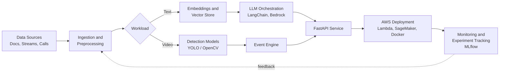

<p align="center">
  
</p>

<p align="center">
  
</p>

<p align="center">
  <a href="mailto:mohdajnas@yahoo.com"></a>
  <a href="https://linkedin.com/in/mohdajnas"></a>
  <a href="https://github.com/mohdajnas"></a>
  
</p>

---

## Overview

I build AI systems that automate decisions, process unstructured data, and scale intelligent workflows in production. My work sits at the intersection of **LLM applications**, **computer vision**, and **cloud-native MLOps**, with a bias toward systems that run reliably under real load.

<table>
  <tr>
    <td width="25%" align="center"><b>Role</b><br/>AI Engineer</td>
    <td width="25%" align="center"><b>Location</b><br/>Kerala, India</td>
    <td width="25%" align="center"><b>Focus</b><br/>LLM · RAG · CV · MLOps</td>
    <td width="25%" align="center"><b>Currently</b><br/>Shipping production AI</td>
  </tr>
</table>

```python
class AjnasKP:
    role      = "AI Engineer"
    focus     = ["LLMs", "RAG", "Computer Vision", "MLOps", "AWS"]
    ask_me_about = ["LangChain", "FastAPI", "OpenCV", "YOLO", "SageMaker", "Bedrock"]
    principle = "Turn complex AI ideas into practical products that solve real problems."
```

---

## Impact at a Glance

| 500+ | 1,000+ | 2 | 2025 |
|:---:|:---:|:---:|:---:|
| Camera feeds monitored in real time | Voice calls handled per day | Industry certifications | AWS ML Engineer Associate and OCI GenAI Professional |

---

## How I Build

A simplified view of the production pattern behind most of my LLM and vision work.



---

## Technical Stack

<table>
  <tr>
    <td width="20%"><b>AI / ML</b></td>
    <td>
      
      
      
      
      
      
      
      
    </td>
  </tr>
  <tr>
    <td><b>Cloud and MLOps</b></td>
    <td>
      
      
      
      
      
      
    </td>
  </tr>
  <tr>
    <td><b>Vector and Data</b></td>
    <td>
      
      
      
      
    </td>
  </tr>
</table>

---

## Featured Work

### AI Incident Management System
**Problem:** Safety teams cannot manually watch hundreds of camera feeds.
**Solution:** Real-time incident detection across 500+ feeds using YOLO and OpenCV, deployed on AWS, giving faster response times and better operational visibility.
<br/>


### AI-Powered IVR System
**Problem:** Traditional IVR menus frustrate callers and cap throughput.
**Solution:** An intelligent voice workflow handling 1,000+ calls per day, combining speech-to-text, text-to-speech, and LLM-based intent detection on AWS services.
<br/>


### AI Entrepreneurship Assistant
**Problem:** Early-stage founders lack accessible, contextual guidance.
**Solution:** A retrieval-augmented assistant offering startup guidance, ideation, and decision support, built with LangChain and FAISS.
<br/>


### Malnutrition Risk Detection Model
**Problem:** Early identification of child malnutrition risk from health indicators.
**Solution:** A machine learning model built and deployed to assess risk levels. Recognized at the Eneria 2.0 Hackathon.
<br/>


---

## Certifications

| Certification | Issuer | Year |
|---|---|---|
| AWS Certified Machine Learning Engineer, Associate | Amazon Web Services | 2025 |
| OCI Generative AI Professional | Oracle Cloud Infrastructure | 2025 |

---

## GitHub Activity

<p align="center">
  
</p>

<p align="center">
  
</p>

---

## Open to Collaborate

I am open to conversations about production LLM systems, RAG architectures, and applied computer vision. The fastest way to reach me is by [email](mailto:mohdajnas@yahoo.com) or [LinkedIn](https://linkedin.com/in/mohdajnas).

<p align="center">
  
</p>

<p align="center"><sub>Not just building AI. Shipping it.</sub></p>
